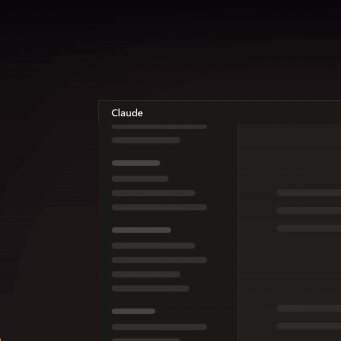

# Claude Recent Chats

**A "Recent chats" panel for the Claude desktop app.** It snaps to the left edge of the Claude window and lists every Code chat you've used, newest first, from every sidebar group. Click one to jump back in.


<p align="center">
  
</p>
<p align="center"><a href="promo/recent-chats-demo.mp4"><b>▶ Watch the demo with sound (13 s)</b></a><br><sub>Music: "Future Bass" by prettyjohn1 via Pixabay</sub></p>

## Why

Sidebar groups are great for keeping chats organised by project. But once you have a dozen groups and a few chats running at once, it's easy to lose track of the one you were in ten minutes ago. Claude's sidebar has no "recent" view across groups.

This panel adds one, without changing anything in the app:

- **Every chat, newest first**, whatever group it's in
- **Status dots**: a pulsing orange dot while Claude is working in a chat, a yellow dot when it has stopped and is waiting on you, a blue dot when there's something new you haven't looked at
- **Its group and how long ago you used it** under each title (`Website · 2m`)
- **Click to open** that chat in Claude
- **Pin chats to the top**: hover a chat and click the pin on its right (click again to unpin)
- **Condensed view**: the arrows button next to ✕ switches to one-line rows
- **Adjustable width**: drag the panel's left edge
- **Snaps to Claude's left edge** with no gap: it moves and resizes with the window and hides when Claude is minimised
- **Read-only and offline**: it only reads Claude's files on your own computer, and sends nothing anywhere
- **One file, no dependencies**: just Python's standard library


## Install

### Easiest: ask Claude to do it

Paste this into a Claude Code chat:

```text
Install Claude Recent Chats for me: https://github.com/mastachef/claude-recent-chats
Follow the "Instructions for Claude" section in its README.
```

### Or one line in PowerShell

```powershell
irm https://raw.githubusercontent.com/mastachef/claude-recent-chats/main/install.ps1 | iex
```

The installer checks for Python, downloads the panel from the [latest release](https://github.com/mastachef/claude-recent-chats/releases/latest) into `%LOCALAPPDATA%\ClaudeRecentChats`, adds the permission-prompt hook to `~\.claude\settings.json` (a backup is saved next to it), adds the panel to Windows startup and starts it. Run it again any time to update.

You need [Python 3.9+](https://www.python.org/downloads/) (the python.org installer includes tkinter). If it's missing, the installer tells you how to get it.

### Uninstall

```powershell
irm https://raw.githubusercontent.com/mastachef/claude-recent-chats/main/uninstall.ps1 | iex
```

This stops the panel, removes it from startup and deletes its folder. Your chats aren't touched.

### Instructions for Claude

If a user asks you to install this, follow these steps in order. Everything runs in PowerShell on the user's own Windows PC.

1. **Check Python.** Run `py -3 -c "import sys, tkinter; print(sys.version)"`. If that fails, try `python` instead of `py -3`. If neither works or the version is below 3.9, ask the user before installing Python, then run `winget install -e --id Python.Python.3.12` and open a new shell.
2. **Install.** Run `irm https://raw.githubusercontent.com/mastachef/claude-recent-chats/main/install.ps1 | iex`. It prints `[ok]` lines and ends with `Running.` It adds a hook to `~\.claude\settings.json`, so Claude Code's auto mode may refuse to run it for you. If so, give the user the command to run in their own PowerShell window.
3. **Verify.** Run `Get-CimInstance Win32_Process -Filter "Name='pythonw.exe'" | Where-Object { $_.CommandLine -like '*recent_chats.pyw*' }`. One process should be listed. Then confirm the shortcut `Claude Recent Chats.lnk` exists in `[Environment]::GetFolderPath('Startup')`.
4. **Tell the user** that the panel is on the left edge of their Claude window, that clicking a chat opens it, and that the ✕ hides it until Claude is next opened. Don't take screenshots of their screen to check: it shows their private chat titles.

Do not move or resize the user's Claude window, and don't edit Claude's own files. The panel only reads them.

### Run it by hand

```bash
pythonw recent_chats.pyw
```

### Try it with sample data

```bash
pythonw recent_chats.pyw --demo
```

This shows made-up chats instead of yours, like the screenshot above. It's handy for screenshots.

## Settings

Pins, the condensed view and the width are saved as you change them, in `%LOCALAPPDATA%\ClaudeRecentChats\settings.json`. Updating keeps them; uninstalling deletes them.

For the rest, change these at the top of `recent_chats.pyw`:

```python
WIDTH = 270    # starting panel width at 100% display scaling
SHOW = 40      # how many chats to list (pinned chats come on top of these)

BG, ROW_HOVER, TEXT, DIM, ACCENT = '#1f1f1e', '#2c2c2a', '#e8e6e1', '#8f8d88', '#d97757'
```

## How it works

| What | Where it comes from |
| --- | --- |
| Chat titles and last-used times | `%APPDATA%\Claude\claude-code-sessions\<account>\…\local_*.json`, for the signed-in account only (named in `%APPDATA%\Claude\config.json`). After an account switch the old folder keeps stale copies the app no longer shows |
| Sidebar groups | `%APPDATA%\Claude\claude_desktop_config.json` |
| In progress (orange dot) | a turn has started but not ended: the chat's last turn edge is the start of your latest message. Matches the app's own running flag |
| Waiting on you (yellow dot) | Claude is showing you a question or plan to approve (read from the end of the chat's transcript in `~\.claude\projects`), or a permission prompt (see below), or the last turn ended blocked on you or failed and you haven't replied since |
| Permission prompts | the app keeps these only in memory, so the installer adds a Claude Code `Notification` hook to `~\.claude\settings.json`. When a prompt has been open about 6 seconds, Claude Code runs `recent_chats.pyw --hook`, which leaves a small marker file. The dot stays yellow until the chat's transcript moves on (you answered). The hook only writes that file; uninstalling removes it |
| Unread (blue dot) | the chat had activity after you last focused it (older chats with no focus time count as read) |
| Opening a chat | the `claude://claude.ai/epitaxy/<session id>` link, which Windows hands to the Claude app |
| Docking | the panel keeps itself directly above the Claude window and hides when Claude is minimised. It snaps to Claude's visible edge and covers its 1-pixel border, so the two read as one window. It is deliberately not an "owned" window: owning a window from another program ties the two programs' input together and made dragging Claude laggy |

It follows the Claude window through Windows move events, so it keeps up instantly. Rows are drawn on a single canvas and wheel movement is applied once per frame, so fast scrolling stays smooth. Every 2 seconds it checks for chat changes, re-reading only files that changed (about 8 ms).

## FAQ

**Does it change my chats or settings?**
No. It only reads files. Nothing is moved, renamed, pinned or grouped.

**Mac or Linux?**
Not yet: the docking uses Windows APIs. Pull requests are welcome.

**It stopped working after a Claude update.**
It reads the desktop app's internal files, which can change between versions. Please open an issue.

## Disclaimer

This is an unofficial community tool. It isn't made or endorsed by Anthropic.

## License

[MIT](LICENSE)
