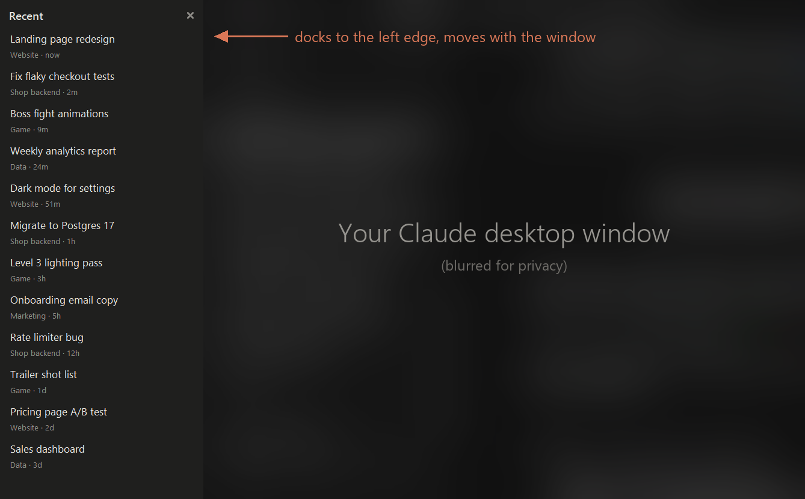

# Claude Recent Chats

**A "Recent chats" panel for the Claude desktop app.** It snaps to the left edge of the Claude window and lists every Code chat you've used, newest first, from every sidebar group. Click one to jump back in.




## Why

Sidebar groups are great for keeping chats organised by project. But once you have a dozen groups and a few chats running at once, it's easy to lose track of the one you were in ten minutes ago. Claude's sidebar has no "recent" view across groups.

This panel adds one, without changing anything in the app:

- **Every chat, newest first**, whatever group it's in
- **Its group and how long ago you used it** under each title (`Website · 2m`)
- **Click to open** that chat in Claude
- **Snaps to Claude's left edge** with no gap: it moves and resizes with the window and hides when Claude is minimised
- **Read-only and offline**: it only reads Claude's files on your own computer, and sends nothing anywhere
- **One file, no dependencies**: just Python's standard library

## Quick start

1. Install [Python 3.9+](https://www.python.org/downloads/) (the python.org installer includes tkinter).
2. Download [`recent_chats.pyw`](recent_chats.pyw).
3. Double-click it, or run:

```bash
pythonw recent_chats.pyw
```

The panel appears next to your Claude window. Close it with the ✕ at the top.

### Start it with Windows

Press `Win + R`, type `shell:startup` and press Enter. In that folder, create a shortcut with:

| Field | Value |
| --- | --- |
| Target | `pythonw.exe "C:\path\to\recent_chats.pyw"` |
| Start in | the folder that holds `recent_chats.pyw` |

### Try it with sample data

```bash
pythonw recent_chats.pyw --demo
```

This shows made-up chats instead of yours, like the screenshot above. It's handy for screenshots.

## Settings

Change these at the top of `recent_chats.pyw`:

```python
WIDTH = 270    # panel width at 100% display scaling
SHOW = 40      # how many chats to list

BG, ROW_HOVER, TEXT, DIM, ACCENT = '#1f1f1e', '#2c2c2a', '#e8e6e1', '#8f8d88', '#d97757'
```

## How it works

| What | Where it comes from |
| --- | --- |
| Chat titles and last-used times | `%APPDATA%\Claude\claude-code-sessions\…\local_*.json` |
| Sidebar groups | `%APPDATA%\Claude\claude_desktop_config.json` |
| Opening a chat | the `claude://claude.ai/epitaxy/<session id>` link, which Windows hands to the Claude app |
| Docking | the panel is an "owned" window of Claude's, so it stays just above it and hides with it. It snaps to Claude's visible edge and covers its 1-pixel border, so the two read as one window |

It checks for changes every 3 seconds and only redraws when something changed.

## FAQ

**Does it change my chats or settings?**
No. It only reads files. Nothing is moved, renamed, pinned or grouped.

**Mac or Linux?**
Not yet: the docking uses Windows APIs. Pull requests are welcome.

**It stopped working after a Claude update.**
It reads the desktop app's internal files, which can change between versions. Please open an issue.

## Disclaimer

This is an unofficial community tool. It isn't made or endorsed by Anthropic.

## License

[MIT](LICENSE)
